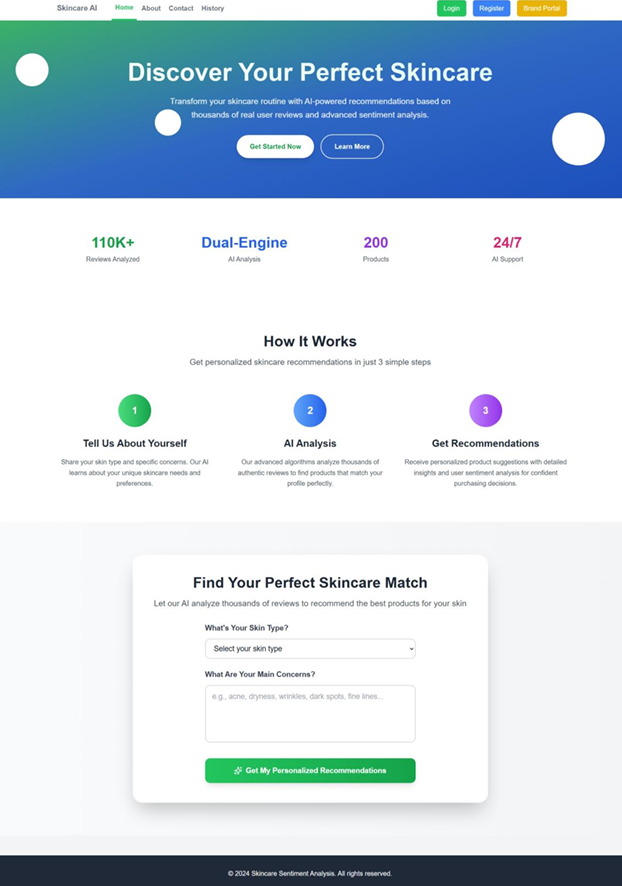
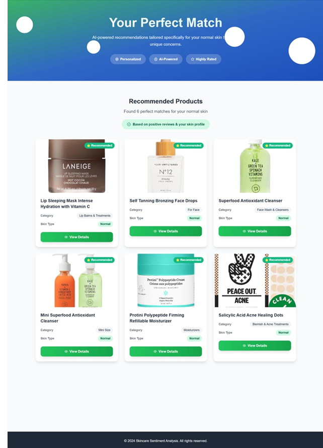
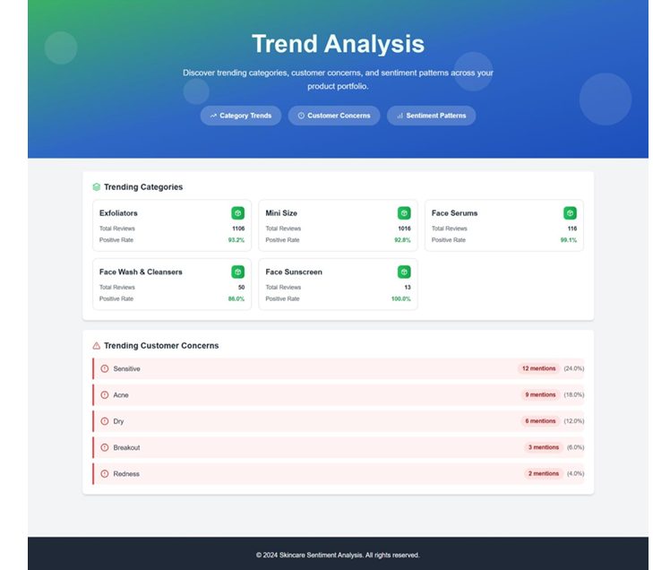

# Skincare Product Sentiment Analysis & Recommendation System

**Graduation project | King Khalid University | Information Systems**

A collaborative Flask web application for exploring skincare product feedback, classifying review sentiment, and supporting product recommendations. Developed by **Nourah Alqarni, Manal Alzahrani, and Reema Alamri**.

> **Public portfolio edition:** Original imported datasets, SQL database dumps, local sessions and account records are deliberately excluded. A small fictional demo dataset is provided instead. This repository is an academic demonstration, not a production security-audited service.

## Features implemented in the codebase

- Customer registration, login and role-based routes (user, brand, influencer, admin)
- Product browsing, reviews and recommendations by skin type/concerns
- Sentiment processing with **VADER** and **TextBlob**
- Brand dashboards, sentiment trends and Excel export
- Influencer insights, pros/cons and suspicious-review scoring with **Isolation Forest**
- Admin management pages for products, users and reviews

## Technology

Python, Flask, Flask-SQLAlchemy, Flask-Login, Flask-Session, MySQL (original application), SQLite (portable demo), Pandas, NumPy, scikit-learn, VADER, TextBlob, HTML, CSS and JavaScript.

## Run locally (Windows PowerShell)

Install Python and run these commands from the project folder:

```powershell
py -m venv .venv
.\.venv\Scripts\Activate.ps1
python -m pip install -r requirements.txt
python seed_demo.py
python app.py
```

Then open `http://127.0.0.1:5000`. If PowerShell blocks activation, use `.venv\Scripts\python.exe` in place of `python` in the last three commands.

By default, the portfolio edition uses **SQLite** (`instance/skincare_demo.db`), which is generated locally and ignored by Git. `seed_demo.py` inserts three fictional products and six fictional reviews; it creates **no login accounts**. You can register a regular user through the app. Admin, brand and influencer screens require their corresponding roles and may need additional demo setup. The full experience with the original imported dataset is not included in this public edition.

### Optional MySQL configuration

Set `DATABASE_URL` to a MySQL SQLAlchemy connection string if you have a separate local MySQL database. Set `SECRET_KEY` to a random secret before deployment. Do not commit real passwords or environment files. `FLASK_DEBUG=1` enables debug mode **only for local development**.

## Repository layout

- `app.py`, `config.py`, `models.py`, `auth.py` — Flask entry point, settings, models and authentication
- `routes/` — main, admin, brand and influencer routes
- `services/` — sentiment, recommendations, analytics, trends, export and suspicious-review logic
- `templates/`, `static/` — UI and frontend assets
- `seed_demo.py` — synthetic demo records
- `.gitignore` — excludes sessions, caches, local databases and secrets

## Data and responsible publication

The original imported reviews and database dump were not redistributed because their provenance, licensing and account data have not been independently verified. All records created by `seed_demo.py` are fictional examples.

## Project status

Code packaged for public review; a full end-to-end test with all roles and dependencies has **not yet been completed**. Screenshots and deployment are planned.

## Contributors

Nourah Alqarni · Manal Alzahrani · Reema Alamri — King Khalid University


## Application Screenshots

### Home Page
Users can enter their skin type and skincare concerns to request recommendations.



### Personalized Product Recommendations
Example product matches displayed for a selected skin type.



### Trend Analysis Dashboard
The brand-facing interface presents category trends, positive-review rates, and customer concerns.



*Screenshots captured from the academic project demonstration. Displayed figures are illustrative and should not be interpreted as independently verified production metrics.*
